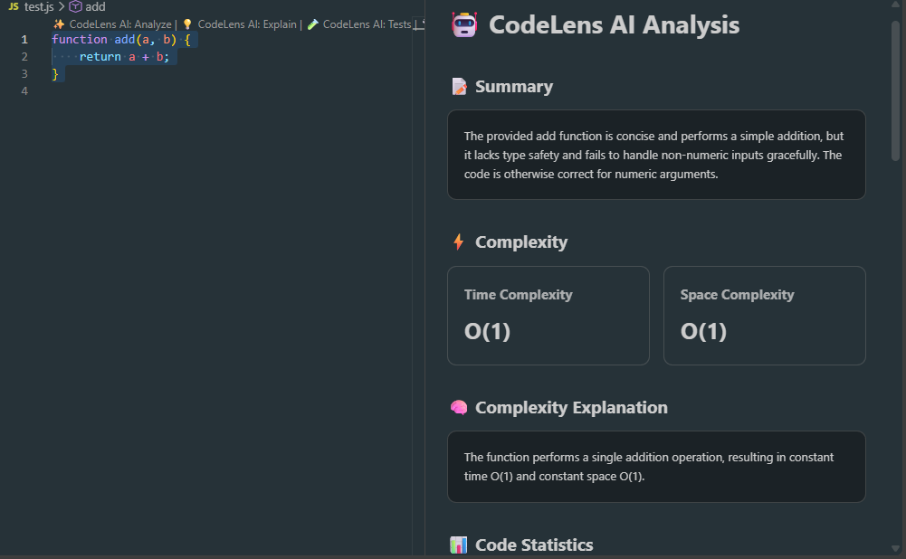
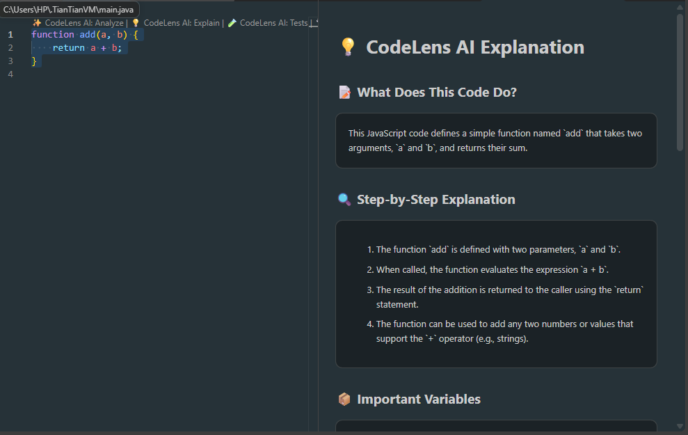
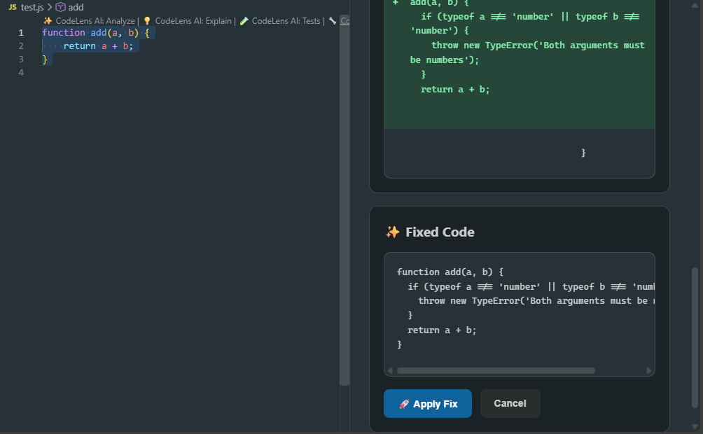
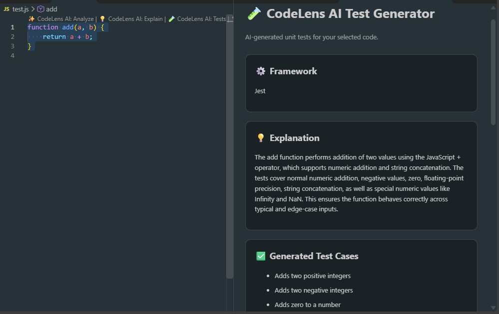
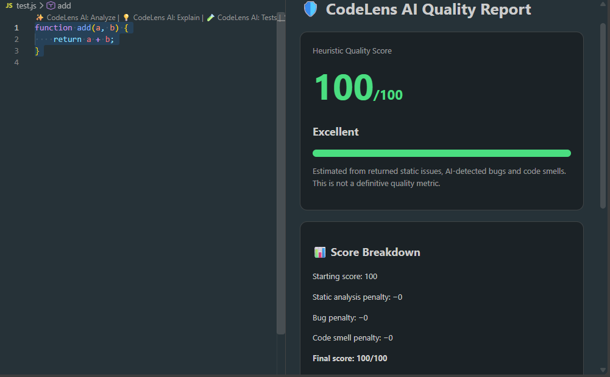

# ⚡ CodeLens AI

### AI-Powered Code Intelligence for Visual Studio Code

**Understand smarter. Debug faster. Write better code.**

CodeLens AI is an AI-powered VS Code extension designed to help developers analyze, understand, improve, and test their code through static analysis and intelligent AI assistance.

<p align="center">
  
  
  
  
</p>

---

## 📸 Project Preview

### 🔍 Code Analysis

Detect potential bugs, code smells, and complexity-related issues in your code.

<p align="center">
  
</p>

### 📖 Code Explanation

Understand code functionality with clear, step-by-step AI-powered explanations.

<p align="center">
  
</p>

### 🛠️ AI Code Fix

Generate suggested code fixes, review changes, and apply improvements to your code.

<p align="center">
  
</p>

### 🧪 Unit Test Generation

Generate test cases for selected functions to help validate code behavior.

<p align="center">
  
</p>

### 📊 Code Quality Score

Evaluate code quality using a heuristic score based on detected bugs, issues, and code smells.

<p align="center">
  
</p>

<p align="center">
  <i>Analyze, understand, fix, and test your code — all with CodeLens AI inside VS Code.</i>
</p>


---

## ✨ Features

| Feature                     | Description                                                                       |
| --------------------------- | --------------------------------------------------------------------------------- |
| 🔍 **Code Analysis**        | Detect potential bugs, code smells, and complexity-related concerns.              |
| 📖 **Code Explanation**     | Understand functions through clear, step-by-step AI explanations.                 |
| 🛠️ **AI Code Fix**         | Generate suggested fixes and review code changes before applying them.            |
| 🧪 **Unit Test Generation** | Generate test cases for selected functions.                                       |
| 📊 **Code Quality Score**   | Calculate a heuristic quality score using detected issues, bugs, and code smells. |

---

## 🧰 Tech Stack

**Editor Extension**

* Visual Studio Code Extension API
* JavaScript

**Backend**

* Node.js
* Express.js

**AI & Code Intelligence**

* Groq API
* Babel Parser
* `diff` npm package

---

## 🏗️ System Architecture

```text
┌─────────────────────────────┐
│       VS Code Editor        │
│  CodeLens AI Extension      │
└──────────────┬──────────────┘
               │ HTTP Requests
               ▼
┌─────────────────────────────┐
│      Express.js Backend     │
│        Node.js Server       │
└──────────────┬──────────────┘
               ▼
┌─────────────────────────────┐
│     Code Intelligence       │
│  Static Analysis + AI       │
│  Fixes + Tests + Explanations│
└──────────────┬──────────────┘
               │
               ▼
┌─────────────────────────────┐
│       Results in VS Code    │
└─────────────────────────────┘
```

---

## 🚀 Getting Started

### Prerequisites

* [Node.js](https://nodejs.org/)
* [Visual Studio Code](https://code.visualstudio.com/)
* A [Groq API key](https://console.groq.com/)

### 1. Clone the repository

```bash
git clone https://github.com/Vrindapal/Ai-Codelens.git
cd Ai-Code-Intelligence-Agent
```

### 2. Install backend dependencies

```bash
cd backend
npm install
```

### 3. Configure environment variables

Create a `.env` file inside the `backend` directory:

```env
PORT=5000
GROQ_API_KEY=your_groq_api_key
```

> 🔐 **Security:** Never commit your real API key or `.env` file to GitHub.

### 4. Start the backend server

```bash
npm start
```

Keep the backend terminal running.

### 5. Launch the VS Code extension

1. Open the `vscode-extension` folder in VS Code in a separate window.
2. Install the project's extension dependencies if required.
3. Open **Run and Debug**.
4. Select the extension launch configuration.
5. Press **F5** to open the Extension Development Host.

Select code in the development host and try the CodeLens AI commands.

---

## 🔌 API Endpoints

| Method | Endpoint       | Purpose                    |
| ------ | -------------- | -------------------------- |
| `POST` | `/api/analyze` | Analyze selected code      |
| `POST` | `/api/explain` | Explain code functionality |
| `POST` | `/api/fix`     | Generate a suggested fix   |
| `POST` | `/api/tests`   | Generate unit tests        |

---

## 🛡️ Responsible AI Usage

* AI-generated code may contain errors and should be reviewed before use.
* Suggested fixes should be checked before being applied.
* Generated tests should be validated against expected behavior.
* The quality score is heuristic and does not guarantee correctness, performance, or security.

---

## 🔮 Future Roadmap

* [ ] AST-based function detection
* [ ] Support for additional programming languages
* [ ] Repository-wide code understanding
* [ ] Automated test execution and coverage reporting
* [ ] More comprehensive code quality metrics

---

## 👩‍💻 Author

**Vrinda Pal**

Computer Science & Engineering | Full-Stack Development | AI-Powered Developer Tools

<p>
  <a href="https://github.com/Vrindapal">GitHub</a> ·
  <a href="https://linkedin.com/in/vrinda-pal-485b04342">LinkedIn</a>
</p>

---

<p align="center">
  <b>⚡ CodeLens AI — Making code easier to understand, improve, and test.</b>
</p>

